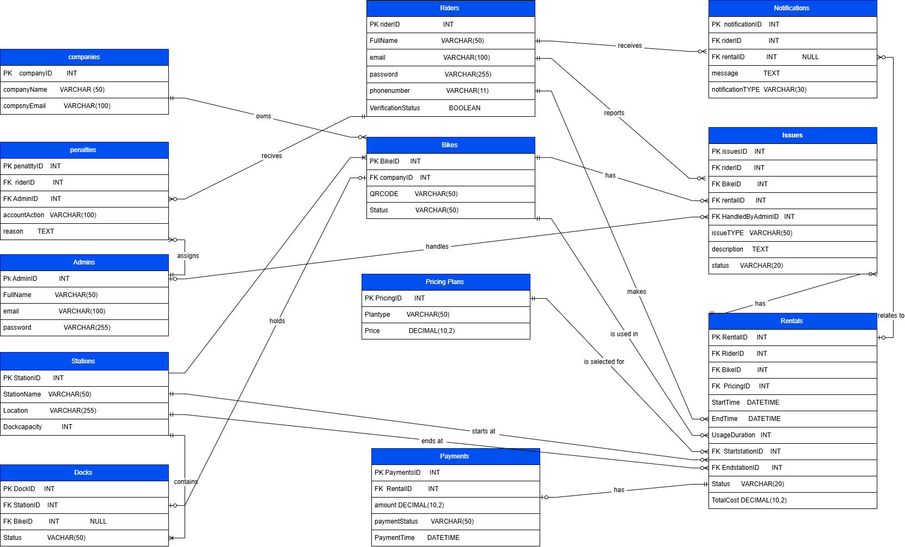

# Smart Bike Rental App - ECOride

Software Engineering - GIU Cairo - Milestone 2

## Team

| Name | ID | Role in team |
|---|---|---|
| Farida | 19009505 | Team Leader |
| Jana | 19005951 | Member |
| Mariam | 19005668 | Member |
| Khalid | 19001099 | Member |
| Malak | 19002778 | Member |
| Hager | 19009681 | Member |
| Marly | 19009051 | Member |
| John | 19006199 | Member |
| Yahia | 19005664 | Member |
| Adam | 19010810 | Member |

## ERD

Editable diagram: [erd.drawio](docs/erd.drawio)

## Traceability: entities to user stories

| Entity | Justified by user stories |
|---|---|
| riders | US-001, US-002, US-003 |
| companies | US-028, US-029 |
| admins | US-021, US-022, US-023, US-024, US-025, US-026, US-027 |
| bikes | US-004, US-006, US-007, US-022, US-028 |
| stations | US-005, US-012, US-023 |
| docks | US-005, US-012, US-023 |
| pricing_plans | US-010, US-027 |
| rentals | US-008, US-009, US-010, US-011, US-012, US-013, US-014 |
| payments | US-015, US-016 |
| issues | US-018, US-025 |
| penalties | US-026 |
| notifications | US-019 |

## Database

- DBMS: PostgreSQL <version>
- Database name: smart_bike_rental
- Scripts are in the `schema/` folder; run them in numeric order.
